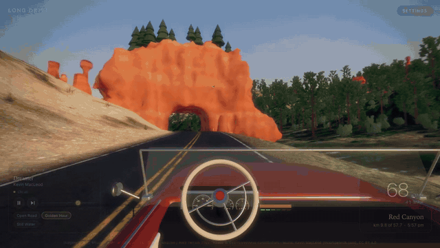
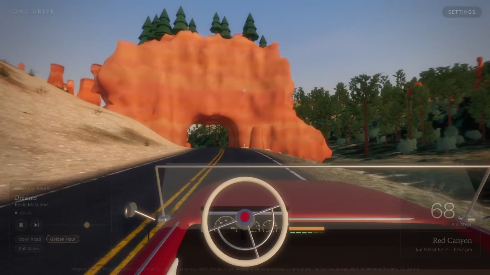
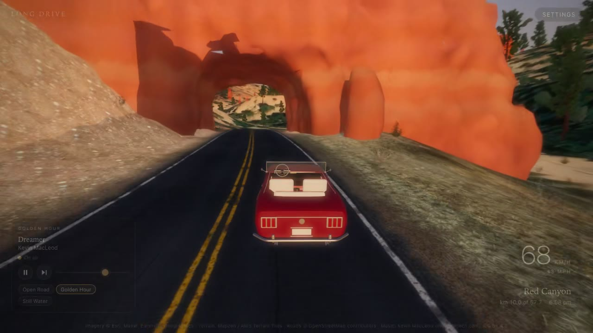
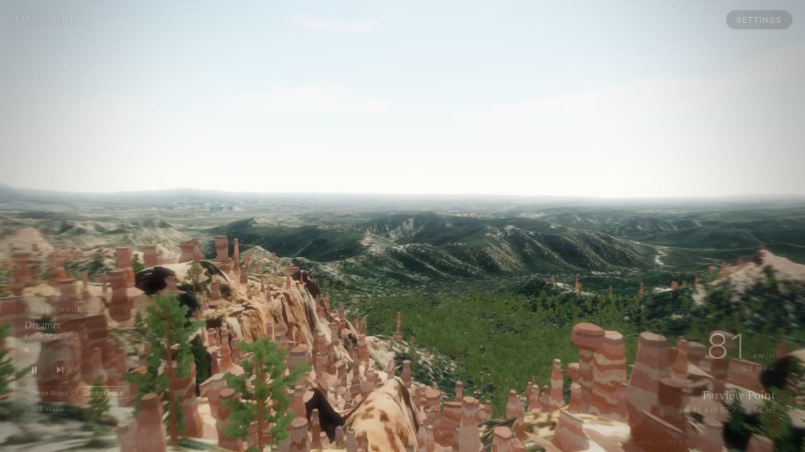
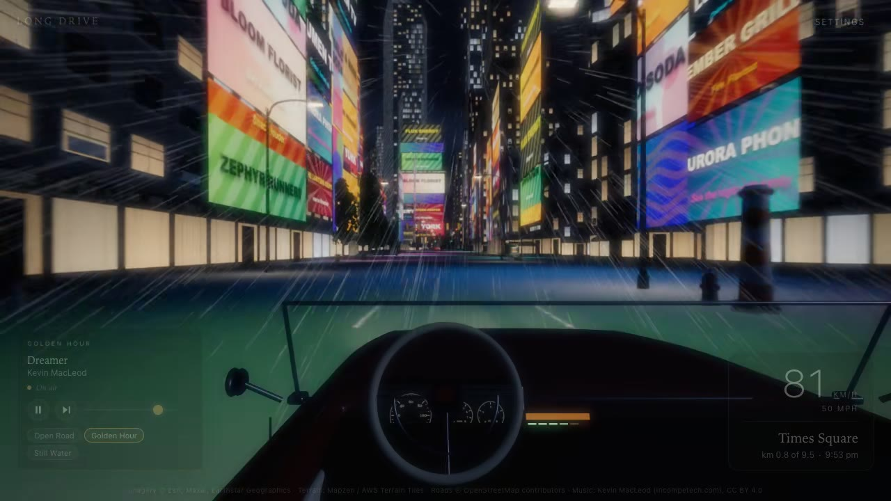
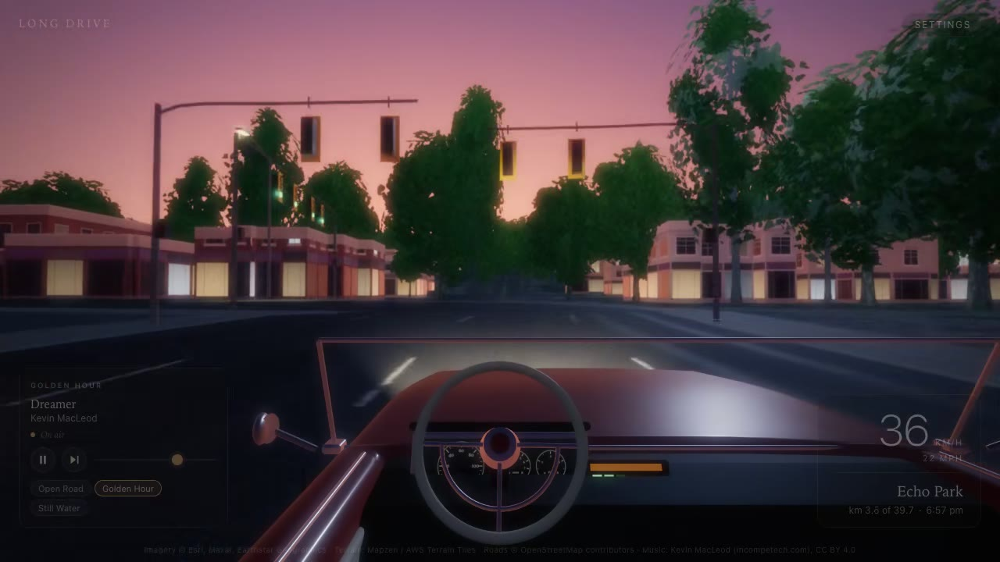
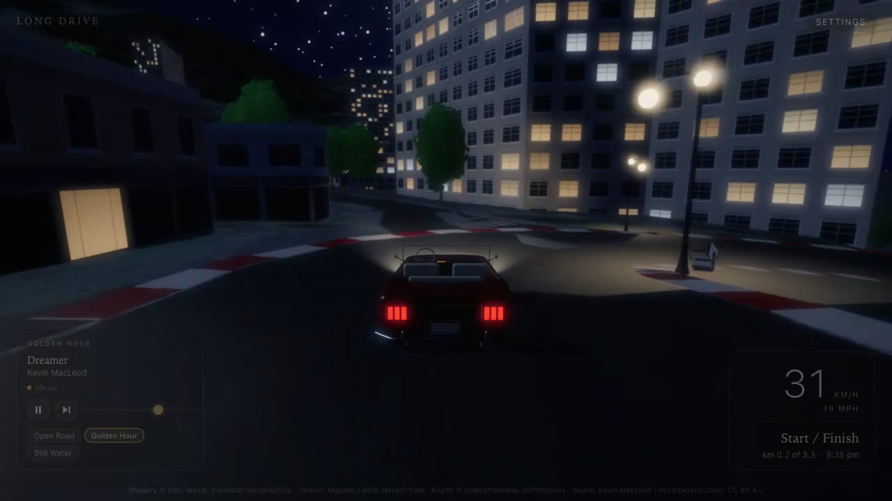
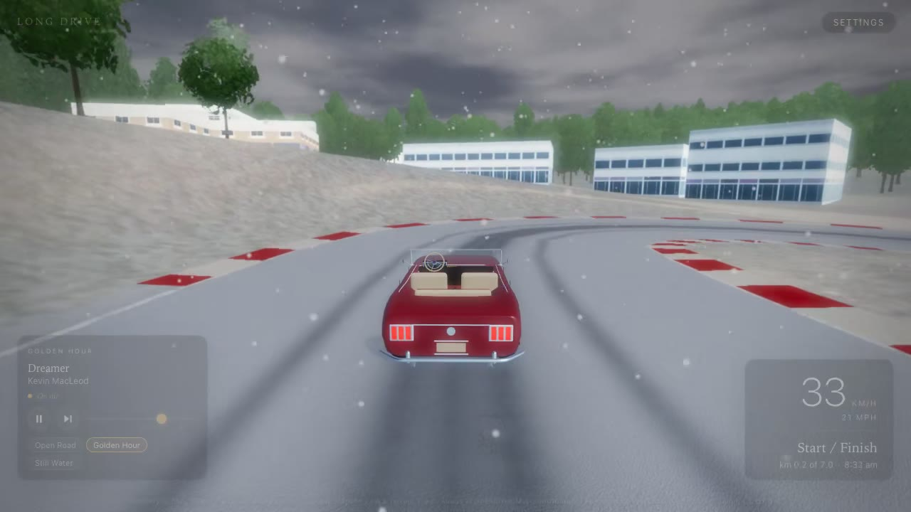
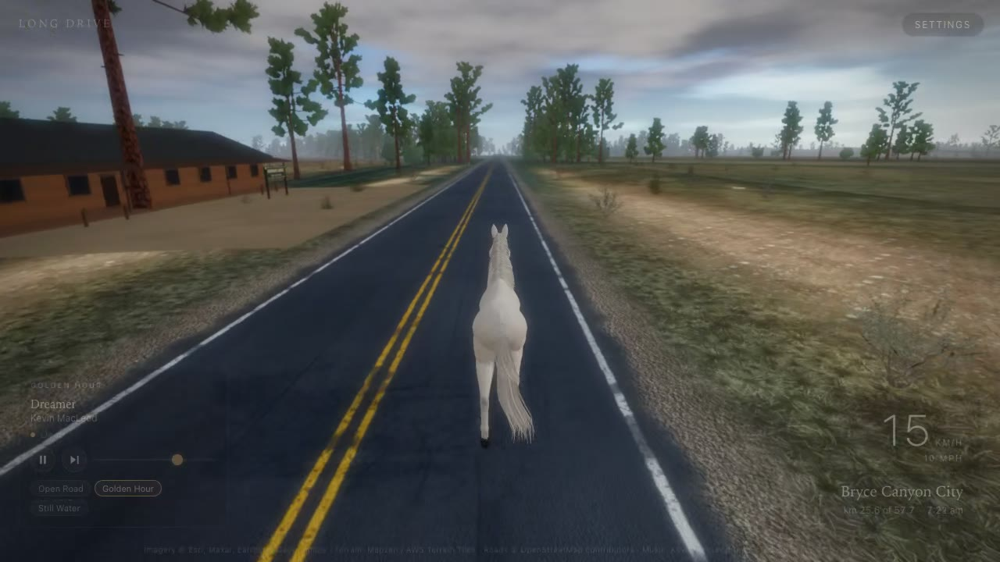

# Long Drive

**A calm, endless drive through real places — built entirely from open map data, running in your browser.**

<p align="center">
  <a href="https://shubham8111.github.io/long-drive/"><b>▶ Drive it now</b></a> ·
  <a href="https://shubham8111.github.io/long-drive/trailer/"><b>Watch the 2-minute trailer</b></a>
</p>

<p align="center"><a href="https://shubham8111.github.io/long-drive/trailer/"></a></p>

## Why this exists

Long Drive is not a racing game. There is no score, no map to finish, no timer, nothing to win.

It is the feeling of a long drive with the windows down: a red convertible (or a horse) rolling along a real road at an
easy pace, the light slowly changing, a radio host who knows a little about where you are, and music you like.
It is meant to be left running, on a laptop or cast to a TV, the way you might put on a fireplace video, while you
read, work, unwind or fall asleep. Turn on *Wind down after an hour* and night falls, the car eases off and the music
fades away.

The places are real. Roads, buildings, terrain and imagery come from open data, so Bryce Canyon's hoodoos stand
where they stand, Times Square's screens glow at the right corner, and the Red Canyon arches are where Utah cut them
in 1925. The goal is *perceived* realism — a place that feels right at a glance — rather than survey-grade detail.

## Places

| | Route | |
|---|---|---|
| 🏜️ | **Bryce Canyon Scenic Drive**, Utah | Red Canyon's rock-arch tunnels, hoodoo amphitheatres, pine and aspen forest, a dark-sky night |
| 🗽 | **Times Square to Washington Square**, Manhattan | Animated billboards (invented brands), the Empire State's lit crown, the arch at the end of Fifth Avenue |
| 🗼 | **Champs-Élysées to Notre-Dame**, Paris | |
| 🌴 | **Sunset Boulevard to the Pacific**, Los Angeles | |
| 🎡 | **Tower Bridge to Hyde Park**, London | |
| 🏁 | **Monaco**, **Silverstone**, **Spa-Francorchamps** | The real Grand Prix circuits, at a Sunday-drive pace |

Every place is a loop, and with *Interleave places* on, a tunnel every few kilometres carries you to a random spot in
another place, so a drive can go on for hours without repeating.

## Screenshots

<p align="center">
   
   
   
   
</p>

## What's in it

- **Real places from open data** — road geometry from OpenStreetMap (via OSRM), terrain from Mapzen/AWS Terrain Tiles,
  ground imagery from Esri World Imagery, buildings from OpenStreetMap (and NYC Open Data for Manhattan).
- **Scenery placed where it really is** — trees are baked from the satellite imagery (canopy where the photo shows
  canopy), species chosen by elevation (juniper → ponderosa → fir, spruce and aspen groves), hoodoo fields grown on
  the steep bare rock below Bryce's rim, rock arches carved with marching cubes.
- **Time and weather** — a full day/night cycle with sun, moon and stars; pick the hour and the weather to start in
  (clear, clouds, overcast, rain or snow) and from there it drifts on its own; wet roads, headlights, lit windows at night.
- **A radio** — three stations of free-licensed music (or paste your own YouTube playlist) and an announcer who
  mentions the weather, the hour and true little facts about what you are passing.
- **Life** — birds, deer, people and light traffic, plus the occasional surprise (hot-air balloons over the canyon,
  a shooting star…).
- **Car or horse**, driver's-seat or chase camera. It drives itself; you just watch.
- **Built for the living room** — runs in Chrome on a laptop; use Chrome's *Cast tab* to put it on a TV.

## Run it locally

```bash
npm install
npm run dev          # http://localhost:5173
```

The dev server downloads map tiles on first use and keeps them in `data/tiles`, so after the first drive a place works
offline. Optional: `npm run voice` installs the neural announcer voice (Kokoro-82M); without it the browser's own voice
is used. The [GitHub Pages version](https://shubham8111.github.io/long-drive/) is a static build that loads tiles
straight from their open sources.

### Add your own place

One small JSON file and one command — see [places/README.md](places/README.md):

```bash
npm run place <id>    # route, terrain, imagery, trees, buildings, street furniture
```

## How it is built

Plain [three.js](https://threejs.org) and [Vite](https://vitejs.dev), no game engine.

| Path | |
|---|---|
| `src/main.js` | the drive loop: route following, U-turns, tunnels between places, camera, quality |
| `src/terrain.js`, `src/tiles.js` | streamed quadtree terrain with satellite imagery, flattened under the road |
| `src/elements.js`, `src/assets.js`, `src/models.js` | instanced trees/shrubs/rocks with impostors, procedural species, Poly Haven photoscans |
| `src/landmarks/` | hand-made places: Times Square, Washington Square Arch, Empire State crown, Red Canyon arches, hoodoo fields, park signs |
| `src/sky.js`, `src/post.js` | sky, clouds, weather, soft post-processing |
| `src/radio.js`, `src/audio.js` | the radio host, music, synthesized engine/wind/rain sound |
| `scripts/` | the place builder: route baking, world baking (trees from imagery), buildings, street furniture, hoodoos |
| `dev/` | test and capture tools (`film.mjs` records frame-perfect clips with the game's own sound) |

## Credits

- Map data © [OpenStreetMap](https://www.openstreetmap.org/copyright) contributors (ODbL); routing by [OSRM](https://project-osrm.org).
- Imagery © Esri, Maxar, Earthstar Geographics ([Esri World Imagery](https://www.arcgis.com/home/item.html?id=10df2279f9684e4a9f6a7f08febac2a9)).
- Terrain: [Mapzen / AWS Terrain Tiles](https://registry.opendata.aws/terrain-tiles/).
- Manhattan building footprints: [NYC Open Data](https://data.cityofnewyork.us/) (Building Footprints).
- Rock and shrub photoscans: [Poly Haven](https://polyhaven.com) (CC0).
- In-game music: [FreePD](https://freepd.com) (CC0) — see `public/music/CREDITS.txt`.
- Trailer music: "Dreamer" by Kevin MacLeod ([incompetech.com](https://incompetech.com)), licensed under
  [Creative Commons: By Attribution 4.0](https://creativecommons.org/licenses/by/4.0/).
- Announcer voice: [Kokoro-82M](https://huggingface.co/hexgrad/Kokoro-82M) (Apache-2.0).

Brands on the Times Square screens and the shop names in Bryce Canyon City are invented.

Built with [Claude Code](https://claude.com/claude-code).
